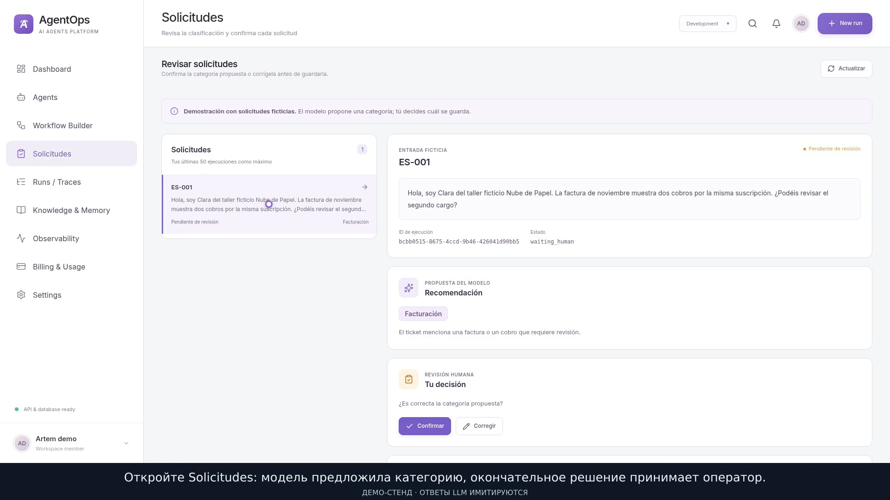

# AgentOps: создание агента и обработка заявок

[Открыть или скачать MP4](presentations/agentops-guide-ru/agentops-guide-ru.mp4) · [Субтитры SRT](presentations/agentops-guide-ru/agentops-guide-ru.srt) · [Главы TXT](presentations/agentops-guide-ru/chapters.txt)

Длительность — 3 минуты 59,56 секунды. Видео: 1920×1080, H.264, 25 кадров/с, около 4,3 МБ. Русские титры встроены в кадр; звуковой дорожки нет. Если GitHub показывает страницу файла, используйте **View raw** или кнопку скачивания.

Запись сделана на отдельном учебном стенде. **Ответы LLM имитируются**: эта пометка видна на протяжении всего ролика. Приложение, PostgreSQL, создание агента, выполнение workflow, HTTP-запись в тестовое хранилище и аварийный перезапуск worker настоящие. Нажатия в интерфейсе автоматизированы, данные вымышленные. Тег `qwen2.5:3b` в форме служит примером настройки; веса модели при этой записи не использовались, её качество и поддержка языков не проверялись.

## Главы

| Время | Что показано |
| --- | --- |
| 00:00 | Вступление и описание учебного стенда |
| 00:22 | Agents → New agent: имя, runtime, модель, инструкции и разрешения |
| 01:06 | Подключение агента к подготовленному workflow и контракту `ticket_classification v1` |
| 01:38 | Запуск с вымышленной испанской заявкой ES-001 |
| 01:58 | `/console/triage/`: рекомендация и подтверждение через Confirmar |
| 02:21 | Остановка worker после записи, ожидание lease и восстановление того же запуска |
| 02:51 | Вторая заявка: Corregir → Acceso → сохранение исправления |
| 03:33 | Runs / Traces: состояние и журнал событий |

## Как повторить процесс

1. Подготовьте локальный стенд по [инструкции triage](triage-demo.md): PostgreSQL, web, worker и Ollama. Для настоящей модели выполните проверку структурированного ответа; сохраните точный digest и версию Ollama.
2. В **Agents → New agent** задайте имя, статус **Active**, доступный runtime, точный тег модели и инструкции классификации. В демонстрации temperature равна 0, инструменты агента не выбраны. Нажмите **Save agent**.
3. В **Workflow Builder** откройте подготовленный сценарий `classify → approval → approved → save_ticket`. Назначьте созданного агента узлу `classify`, выберите `ticket_classification v1` и сохраните workflow. Подтверждение проверяет отдельный узел `approved`, запись выполняет `save_ticket`.
4. Запустите workflow с вымышленной заявкой. После перехода в `waiting_human` откройте [экран оператора](http://127.0.0.1:8010/console/triage/), проверьте рекомендацию и выберите **Confirmar** либо **Corregir** с окончательной категорией. Для исправления можно добавить пояснение; отправьте его кнопкой **Guardar corrección**.
5. Дождитесь обработки решения worker и проверьте сохранённую квитанцию и события запуска. Контролируемый сбой выполняйте по [инструкции проверки](triage-demo.md#repeatable-proof), используя отдельный тестовый стенд.

Адрес `127.0.0.1:8010` относится к web-приложению на вашем компьютере. Ollama на `127.0.0.1:11435/v1` обслуживает API модели; страницу оператора открывайте на порту web.

## Запись и результаты проверки

Версия приложения при записи: [`90c6000a50f90cc2d749f91bbd6edcab2453ed90`](https://github.com/Artem7898/ai-agents-platform/commit/90c6000a50f90cc2d749f91bbd6edcab2453ed90). В опубликованном комплекте сохранены:

- [Журнал записи и событий](presentations/agentops-guide-ru/recording-evidence.json): входные данные, workflow, решения, идентификаторы и результаты обоих запусков.
- [Итоговая проверка backend](presentations/agentops-guide-ru/backend-final-verification.json): исходный запуск завершён, одна квитанция, две попытки команды продолжения, запросы `created` и `replayed` возвращают одну квитанцию; исправление второй заявки сохранено как `Acceso`.
- [Проверка воспроизведения в Chromium](presentations/agentops-guide-ru/playback-verification.json) и [проверка кодирования](presentations/agentops-guide-ru/encoding-verification.json): воспроизведение, полный проход декодирования и `faststart`.
- [Параметры MP4](presentations/agentops-guide-ru/agentops-guide-ru.metadata.json) и [SHA-256 файлов](presentations/agentops-guide-ru/manifest.json).

Абсолютные пути `/workspace/...` в отчётах обозначают расположение исходных материалов в среде записи. Опубликованные файлы находятся в [папке презентации](presentations/agentops-guide-ru/).

Проверка восстановления относится к этому тестовому хранилищу с атомарным ключом `<run_id>:save_ticket:tool`. Для сторонних систем нужны их собственные гарантии идемпотентности. Запись не подтверждает качество классификации настоящей моделью.
